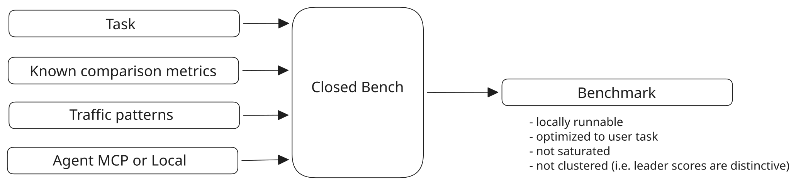

# Closed_bench



Closed_bench turns a plain-language testing goal into a repeatable evaluation. It
extracts requirements, finds benchmarks and ground truth, builds test cases,
runs systems under the same conditions, and reports scores with supporting
traces. It includes a local web UI and the `closed-bench` command.

## Setup

Requires Python 3.10 or newer. From this repository:

```bash
python3 -m venv .venv
source .venv/bin/activate
pip install -e '.[web]'
cp .env.example .env
```

Set `OPENAI_API_KEY` in `.env` for model-assisted steps. The example file lists
optional model and run-directory settings. Then run `closed-bench serve` for
the local UI, or `closed-bench --help` for the CLI. For development, install
`.[dev,web]` and run `git config core.hooksPath .githooks` once to enable
commit-time lint checks.

## Engineering log

| Date | Context | Change | Result |
| --- | --- | --- | --- |
| 2026-09-27 | Flat source layout made modules hard to navigate. | Put each Python module in its own package directory and keep import paths stable. | Clear ownership without changing the public Python imports. |
| 2026-09-27 | Project name and license needed to reflect the current direction. | Renamed Auto-Eval to Closed_bench and changed the license to GPLv3. | Consistent project naming and GPLv3 terms for new releases. |
